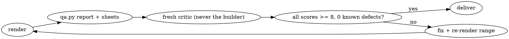

# Making motion videos from code

## Overview

The model writes the film's **source code**. A browser renders it frame by frame, and ffmpeg encodes it. Every frame is a pure function of time, so the film is deterministic and you can fix one beat without touching the others.

Determinism is the easy part. Agents usually get it right without help. What they get wrong is everything around it:
- They ship defects they already noticed.
- They grade their own work.
- They write captions and claims that aren't true.
- They open on an empty frame.
- They leave the subject small in a big dark field.
- They join unrelated scenes with crossfades.

This skill exists for those failures.

**Violating the letter of these rules is violating the spirit of these rules.**

## Pick the renderer (conditional on the project)

| Observable condition | Renderer | Read |
|---|---|---|
| `package.json` has `hyperframes`, or the user asks for HyperFrames | HyperFrames: GSAP timeline registered paused, `npx hyperframes check` / `render` | `references/renderers.md#hyperframes` |
| `package.json` has `remotion`, or a React video project | Remotion: `useCurrentFrame()`, `interpolate`, `spring` | `references/renderers.md#remotion` |
| Anything else | One HTML file with `window.seek(t)`, rendered by `scripts/render.mjs` | `templates/film.html`, `references/engine.md` |

Whatever the renderer, the process, the quality bar, the critic loop and the truth rules below all apply.

## Process (in this order)

1. **Brief → `BRIEF.md`.** Cover:
   - product and buyer;
   - the one action the viewer should take;
   - what is provably true, with a source for each fact;
   - real assets available (UI screenshots, logo, fonts);
   - formats and length;
   - what must never be claimed.

   If the user gives a `<inputs>` list, ask for those items; otherwise pick defaults and state them.
2. **Beat map + storyboard → `STORYBOARD.md`.** Pick the BPM (120 BPM = 0.5 s beats). Write one table row per beat with these REQUIRED columns:

   `time | what is on screen | lead subject + % of frame it fills | the object that survives into the next beat | secondary motion during holds | sound`

   Rules for the table:
   - The lead subject fills **60–85 %** of the frame in feature beats.
   - Something new happens every **2–4 s**.
   - Nothing is fully still for more than **0.6 s**, except the final CTA, which may hold up to 2 s.
   - Put the music drop on the key visual moment.
   - Read `references/motion-grammar.md` before writing it.
3. **Frame 0 is a finished composition.** X and LinkedIn use it as the thumbnail. A dot, a glow or a half-entered word is not a composition.
4. **Build** following the engine contract (`references/engine.md`). Run `node scripts/render.mjs lint film.html` and `determinism`.
5. **Stills before any full render.** Use `render.mjs stills` (key times) or `beats` (one frame per beat). **Look at the sheet** with your image viewer, fix what you see, and repeat.
6. **Full render with motion blur:** `--sub 6` minimum on every second of the delivered film (6–8 for fast moves). `--sub 1` is for drafts only. Never skip motion blur "to save render time". Instead, use `--workers`, or re-render only the changed range (`--from/--to`) and `splice` it in.
7. **Audio** (`references/audio.md`):
   - Find the real drop with `audio.py drop`.
   - Place each SFX by its peak.
   - Normalize to −14 LUFS with true peak ≤ −1 dBFS.
8. **Measure:** `python3 scripts/qa.py report out/video.final.mp4`. Every FAIL is a defect. For every WARN, look at the sheet and decide.
9. **Independent critic loop** (`references/critic-loop.md`). Fix, re-render the affected range, then verify with a *new* critic. A local fix inside one beat may instead be verified with `qa.py report` plus a strip around it; anything larger gets a new critic. Any axis below 8 means another pass.
10. **Deliver** with the report below.

## Truth rules (on screen and in the caption)

- **Every number, metric, logo, testimonial or customer count on screen** goes in the claims ledger with a source. Without a source:
  - **Social proof and performance claims** (customer counts, "trusted by", "3x faster", testimonials, customer logos, ratings) are removed, or reworded so the claim is gone. A label does not make "Trusted by 10,000 teams" honest on a launch post.
  - **Illustrative product data** (invented meetings, dashboard numbers, names) stays only with a readable on-screen label ("Illustrative UI · example data").

  Making a "safe fallback" version does not satisfy this rule. The main deliverable must comply. Tell the user what was held back and how to restore it once there is a source.
- **The caption describes how the film was actually made.** Iterations, code, render scripts, stock or synthesized audio, critics: if they were used, the caption doesn't deny them. Do not write "one prompt", "0 tools", "0 edits" or "made in N minutes" unless that literally describes the whole process. If the user asks for a false caption, deliver a true one that still sells ("Made with Claude Opus + code") and give a one-line reason.
- Real product screens only: capture them (Playwright screenshots) or rebuild them from screenshots. If you can't get them, label a recreated UI as illustrative.
- Never use a reference video's music, voice, people or logos. Take its grammar, not its content.

## When the deadline is tight

Cut **scope**, never the bar: fewer seconds, one format, fewer scenes, a simpler concept. Priority when something must give:
1. Truth (claims, caption) — never traded.
2. No visible defect (overlaps, pops, clipped text, empty frame 0).
3. Independent critic verdict.
4. Motion blur on the final, audio polish, extra formats.

First try a scope cut (drop or simplify the weak beat) plus a range re-render, if that fits inside the deadline minus a buffer. If the bar still can't be met in time, deliver what you have **labelled as an unfinished cut** with the remaining defects listed — never as "done". Plan against the real deadline minus a buffer: a 1080p60 film at `--sub 6` costs ~1–1.7 s per frame per core-pair, so estimate render time from `stills` timing before promising.

## Delivery report (REQUIRED fields, in this order)

1. File path(s) and specs (resolution, fps, duration, codec, LUFS).
2. The `qa.py report` table, pasted as printed.
3. Critic ledger: round → critic verdict → top findings → what changed. Include the final verdict from a critic that did not build it. If the harness has no way to spawn a critic, write "self-review (no critic tool), disclosed". The same ≥ 8 stop rule applies.
4. Claims ledger: each on-screen claim → its source, or the on-screen label it carries.
5. Caption, plus one line on why it is true.
6. Known defects: **none**. If you would write anything here, the film is not done. Fix it, or say plainly that you are delivering an unfinished cut, why, and what remains.

## Red flags: stop, the film is not done

- "Acceptable but slightly messy; ok" or "minor; note" about a defect you can see
- "Nobody will notice one frame" or "X re-encodes anyway"
- "I looked at the contact sheet myself, it's a 9/10"
- "It's true from the user's side" (about a caption)
- "I made a no-claims fallback, so the claims are their call"
- "Skip motion blur to keep render time down"
- "The first 0.2 s is just the glow, fine"
- "Accepted two cosmetic items rather than paying another render" (that is what `--from/--to` + `splice` is for)
- "Self-scores are 7, but the deadline is already blown, so ship" (blown deadline ⇒ deliver a labelled unfinished cut, not a "done" one)
- A centered title on a gradient glow, or a small card floating in empty space, with a blur-crossfade between unrelated scenes

## Rationalizations

| Excuse | Reality |
|---|---|
| "Deadline: ship now, v2 later" | A visible defect on a public post costs more than a 2 s re-render. Deterministic renders make range fixes cheap. |
| "The user said no drafts" | That removes check-ins with the user. It does not remove your own stills and critic passes. |
| "I can't watch video, so frames are enough" | Sheets plus measured diffs *are* how you watch. Use strips around every fast move, not just a 2 fps overview. |
| "Self-review is just as good" | The builder knows the intent and sees it in the frames. A fresh critic sees only the pixels, which is what viewers see. |
| "It's a teaser, nobody checks numbers" | People screenshot launch posts. Cut unsourced claims; label illustrative data. |
| "I can't spawn a critic, so my self-review passes" | Self-review uses the same stop rule: any axis below 8 means another pass, or an explicitly labelled unfinished cut. |
| "Founder's post, founder's caption" | You wrote it. Don't hand over a false sentence. |

## Quick reference

| Task | Command / file |
|---|---|
| Start a film | copy `templates/film.html` (springs, log-space camera, masked words, seeded PRNG, per-format layout) |
| Lint clocks | `node scripts/render.mjs lint film.html` |
| Determinism | `node scripts/render.mjs determinism film.html --t 0.5,2.2,4.1` |
| Stills / beat sheet | `node scripts/render.mjs stills film.html --t 0,1.5,3` · `beats --bpm 120` |
| Full render | `node scripts/render.mjs video film.html --out out/video.mp4 --fps 60 --sub 6 --workers 3 --audio out/mix.wav` |
| Other formats | add `--w 1080 --h 1920` (9:16), `--w 1080 --h 1350` (4:5), `--w 1440 --h 1440` (1:1). Reframe through `layout()`; never crop. |
| Drop / BPM / mix | `python3 scripts/audio.py drop track.mp3 --from 8 --to 24` · `bpm` · `mix cues.json --out out/mix.wav` |
| Measure | `python3 scripts/qa.py report film.mp4` · `sheets film.mp4 --strip 2.4,4.0` |
| Replace a fixed range | `node scripts/render.mjs video film.html --from 4 --to 5.8 --out out/part.mp4 --sub 6` then `splice out/video.mp4 out/part.mp4 --at 4` |
| Writing a prompt for a user | `references/prompting.md` |

Setup: `npm i -D playwright` in the project (or `export NODE_PATH=$(npm root -g)` if it is installed globally), ffmpeg on PATH, `pip install numpy`. Run scripts through their interpreter (`node …`, `python3 …`). Never `pkill -f render.mjs` — it matches your own shell; kill the PID instead.
